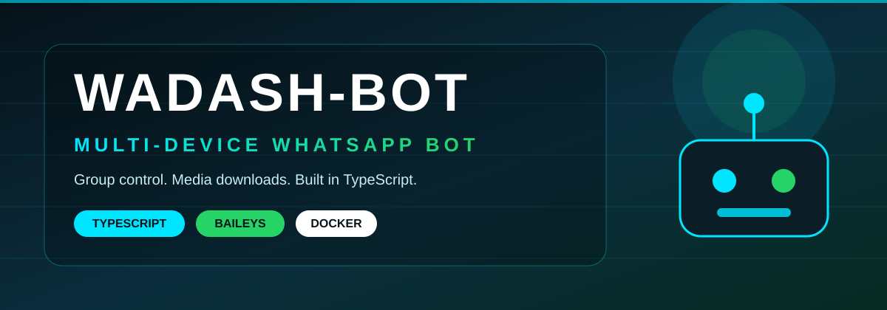
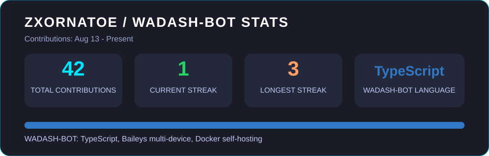

<div align="center">





---


</div>

<p align="center">
  
</p>

WADASH-BOT is a multi-device WhatsApp bot built in TypeScript on Baileys, focused on group control and media downloads. It is a workspace / pnpm project, with recent work on moderation, backups and download routing.

<p align="center">
  
</p>

<div align="center">




</div>

<p align="center">
  
</p>

<div align="center">


</div>

<p align="center">
  
</p>

| Feature | Description | Status |
|---|---|---|
| Multi-Device Support | Runs as a multi-device WhatsApp bot via Baileys | LIVE |
| Group Moderation | Anti-link and anti-badword enforcement in groups | LIVE |
| Edited Message Moderation | Re-checks edited messages for links and bad words | LIVE |
| Backup and Restore | Backup alias, restore and group blacklist controls | LIVE |
| Media Downloads | TikTok / Instagram download routing | LIVE |
| Audio Downloads | YouTube audio via free converters, with fallbacks | LIVE |
| Docker Support | Docker-based setup for self-hosting | LIVE |

<p align="center">
  
</p>

> Setup details to confirm from the project workspace before first run: this is a pnpm TypeScript workspace, not a single-package install.

1. Fork the repo
2. Clone your fork
3. Install with pnpm and build with the workspace scripts

```bash
pnpm install
pnpm run build
```

<p align="center">
  
</p>

If you use WADASH-BOT, starring the repo helps it get found. Thanks to everyone who contributes and reports issues.

<p align="center">
  
</p>

This bot is not made by WhatsApp Inc. Misuse can lead to a WhatsApp ban. Use it at your own risk.

<p align="center">
  
</p>

**Zxornatoe** — Developer and maintainer of WADASH-BOT.

---

> WADASH-BOT — not for sale as a WhatsApp product. Give credit if you reuse or re-upload this work.

<div align="center">


</div>
